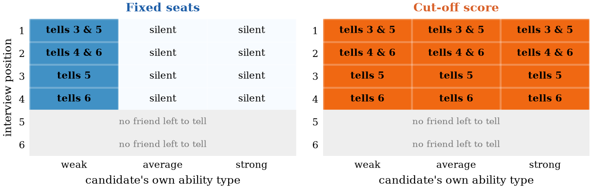
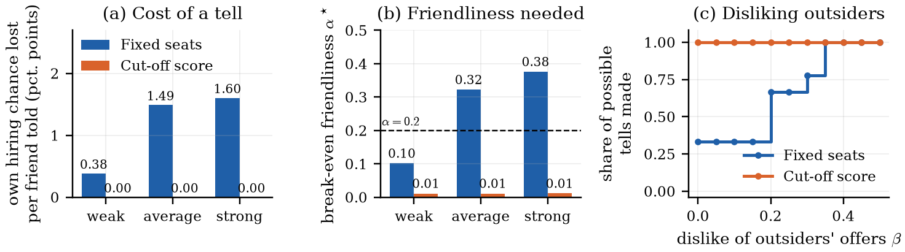
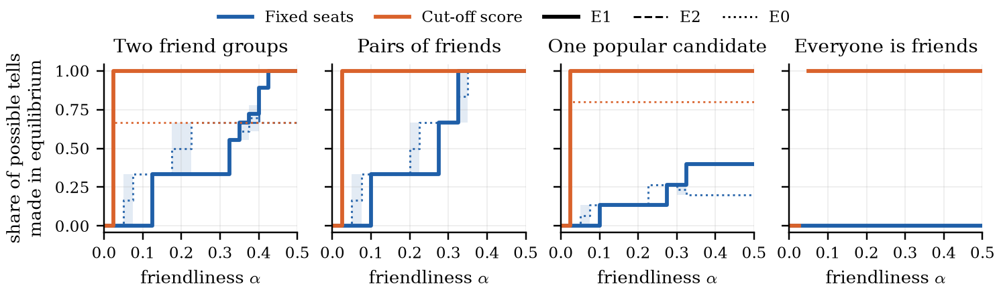
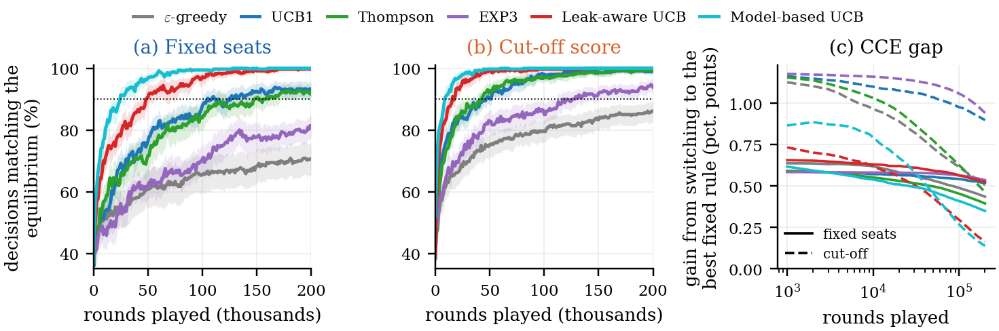
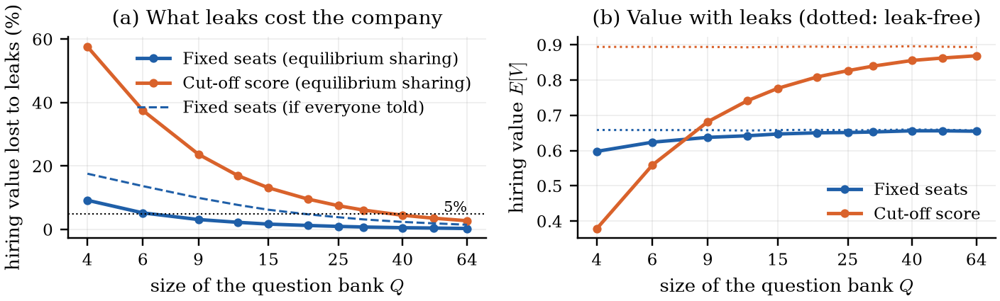
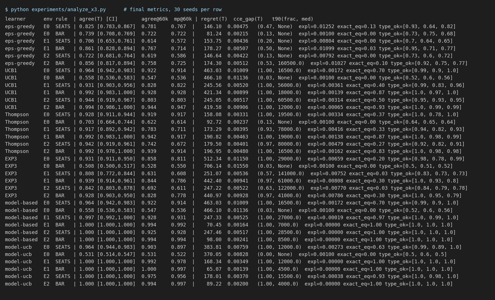
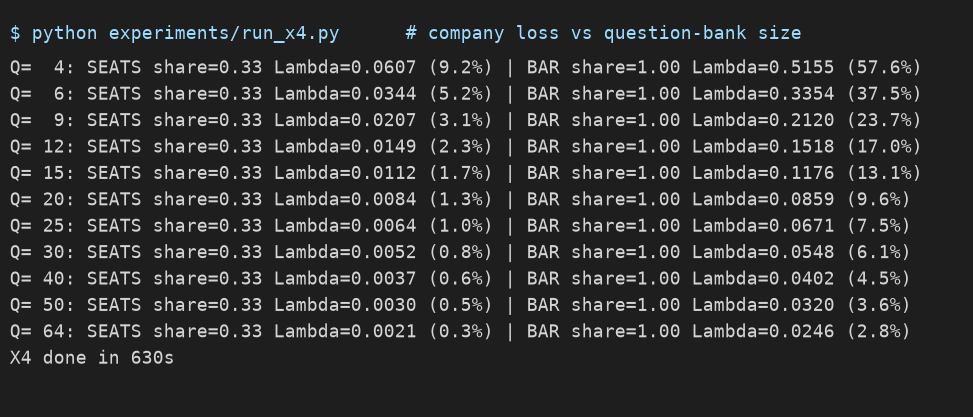
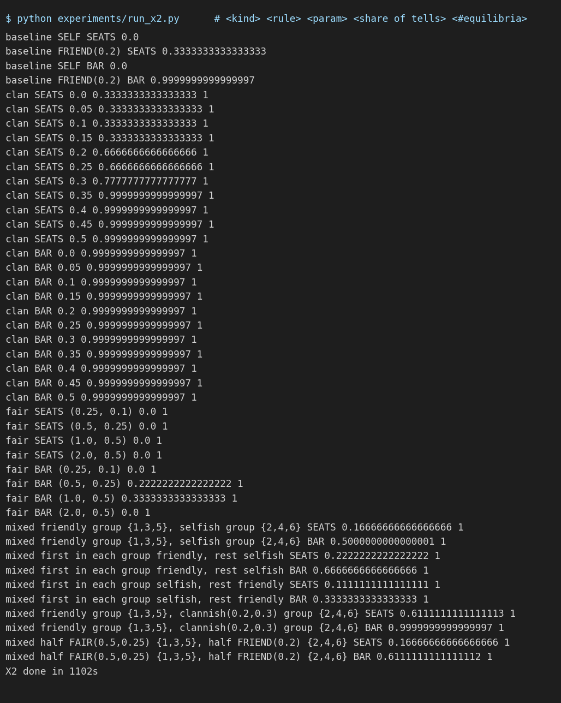
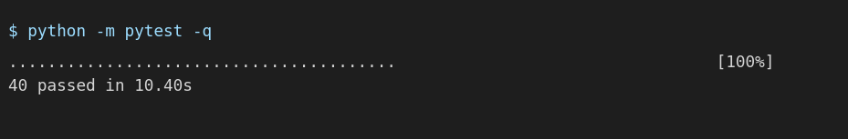

# Leak or Keep? Learning to Share Interview Questions Among Competing Candidates

Final project, Multi-Agent Systems, IIT Gandhinagar.
Jash Bharat Pasad (24110146), Bhavay Goyal (24110070), Chaitanya Bhoite (24110086), Vishnu Sinha (24110389).

**Report:** [`report/main.pdf`](report/main.pdf) (8 pages; LaTeX source in [`report/main.tex`](report/main.tex)).

After an interview, a candidate can tell friends who interview later which questions were asked. That helps the
friends, but they may be competing for the same offers. We model this as a Bayesian game on a sharing matrix,
solve it exactly, and then check whether bandit learners who know none of the rules find the same answer.

Two hiring rules are compared throughout:

- **Fixed seats** (`SEATS` in the code): the best `K` scores are hired.
- **Cut-off** (`BAR` in the code): everyone above a fixed score is hired.

## Results

Every number below is read from the files in `results/` and can be regenerated with the commands in
[Reproducing the results](#reproducing-the-results).

### 1. The hiring rule decides who talks

With two friend groups and candidates who value a friend's offer at 0.2 of their own, the game has exactly one
pure equilibrium under each rule (all 262,144 strategy profiles checked). Under fixed seats only weak candidates
tell; under a cut-off everyone does.



The reason is what a tell costs the teller. Under fixed seats a weak candidate loses 0.38 percentage points of
her own hiring chance per friend told, an average one 1.49 and a strong one 1.60, while the friend gains about
4.5 to 4.9 points in every case. So a weak candidate tells once she values a friend's offer at 0.10 of her own,
an average one at 0.32 and a strong one at 0.38. Under a cut-off the loss is exactly zero.
Panel (c): candidates who dislike outsiders' offers tell *more* under fixed seats (33% to 100% of possible tells)
and exactly the same under a cut-off.



The same staircase appears in every friendship network and leak model we solved (378 games). A candidate who is
friends with everyone never tells under fixed seats, and when everyone is friends nobody does.

Uniqueness is exact in the estimated table. Counting profiles within 0.001 (one message cost) of being an equilibrium,
the α = 0.2 games above still have exactly one. 117 of the 378 games have more than one such near-equilibrium: 17 at
α ≤ 0.025, 62 in leak model E0 (where a redundant tell costs exactly the message cost), and 38 on the steps of the
fixed-seats staircase (up to 64 profiles), where one type is nearly indifferent.

Mixed and correlated equilibria do not change this picture in E1 and E2: the linear programs over all coarse
correlated equilibria give a single sharing level in all 212 games, and iterated strict dominance shows that 311 of
the 378 games have exactly one equilibrium of any kind. In E0 correlated play can share much more or less than the
pure equilibria (see Known limits).



### 2. Learners find the equilibrium, and knowing how leaks work helps

Each (candidate, type) pair is a bandit learner that sees only its own outcome. After 200,000 rounds (30 seeds
per setting, 1,080 runs in total) UCB1 has 93% (fixed seats) and 99% (cut-off) of decisions matching the
equilibrium. Two learners use how leaks work. Leak-aware UCB (UCB1 plus credit for tells that did not land)
reaches 90% in 27,000 and 7,000 rounds, against 56,000 and 18,000 for plain UCB1. Model-based UCB (it estimates
the leak rate and the value of a leaked question by regression, and plans with both) needs 12,000 and 4,500
rounds, and, unlike Leak-aware UCB, also has lower regret than UCB1 under fixed seats (168 against 246 in E1).
Both end at 100% in E1 and E2.

Regret ranks the learners almost the other way round. Under fixed seats (E1), cumulative regret is 154 for
epsilon-greedy and 173 for Thompson sampling, against 246 for UCB1 and 251 for EXP3. UCB1 finds the right answer
but pays more to get there. The CCE gap falls for all six learners, but at 200,000 rounds it is still about the size
of the payoff gaps the learners must detect, so play is closer to a CCE without being near one yet.



### 3. At friendliness 0.2, leaks cost a cut-off company about ten times more, mostly because more people tell

With a bank of 15 questions, equilibrium sharing costs 1.7% of hiring value under fixed seats and 13.1% under a
cut-off. To keep the loss under 5% the company needs 9 questions under fixed seats and 40 under a cut-off.
A cut-off still gives the higher absolute value once the bank has 9 or more questions.

Most of the tenfold gap comes from who tells: at α = 0.2 everyone tells under a cut-off but only weak candidates do
under fixed seats. If everyone told under both rules (dashed line in panel a), fixed seats would lose 6.2% at Q = 15,
the cut-off would lose 2.5 to 4.4 times more, and fixed seats would need 20 questions instead of 9.



### Console output

These images are the text of the log files in `results/logs/`, rendered by
`experiments/make_console_shots.py`.

Learning experiment (X3), one row per learner, leak model and hiring rule (`model-based` is the leak-aware UCB, i.e. UCB1 with counterfactual credit; `model-ucb` is the model-based UCB):



Company-loss experiment (X4):



Utility-type experiment (X2):



Unit tests:



## Reproducing the results

Requirements: Python 3.10 or newer and NumPy 2.0 or newer (the code uses `np.bitwise_count`; `pip install -e .`
pulls the right version). No GPU is needed. Everything ran on a 10-core laptop.

```bash
uv venv .venv
uv pip install --python .venv/bin/python -e ".[dev]"      # Windows: .venv\Scripts\python.exe
```

(`python -m venv .venv && .venv/bin/pip install -e ".[dev]"` works too.)

To regenerate everything in one go (about 75 minutes on a 10-core laptop):

```bash
./run_all.sh
```

Or step by step:

| Step | Command | Writes | Time |
|---|---|---|---|
| Unit tests (40) | `python -m pytest -q` | console | 15 s |
| Verification checks | `python experiments/run_checks.py` | `results/checks/checks.json` | 10 s |
| X1: who tells | `python experiments/run_x1.py` | `results/x1/*.json` | 40 min |
| X1: CCE programs for E0 and E2 | `python experiments/run_cce.py [n_workers] [network:env ...]` | `results/x1/x1_cce_<network>_<env>.json` | 2 h with one worker |
| X1: mixed equilibria (dominance, support enumeration) | `python experiments/run_support.py` | `results/x1/x1_support.json` | 5 min |
| X2: motives | `python experiments/run_x2.py` | `results/x2/x2.json` | 20 min |
| X3: learning | `python experiments/run_x3.py` | `results/x3/x3_<learner>.npz` | 10 min |
| X3: statistics | `python experiments/analyze_x3.py` | `results/x3/x3_summary.json` | 30 s |
| X4: company loss | `python experiments/run_x4.py` | `results/x4/x4.json` | 11 min |
| Figures, tables, numbers | `python experiments/make_figures.py` | `results/figures/`, `report/figures/`, `report/generated/`, `results/numbers.json` | 5 s |
| Console screenshots | `python experiments/make_console_shots.py` | `results/figures/console_*.png` | 2 s |
| Report PDF | `cd report && tectonic main.tex` | `report/main.pdf` | 10 s |

Notes:

- All seeds are fixed, so re-running reproduces the committed result files.
- Payoff tables are cached in `results/tables/` (not committed). They are rebuilt automatically on first use, 15 to
  40 seconds each. The full set took 263 MB before the tables also stored block means of the pairwise hiring
  probabilities (needed to bootstrap fairness utilities); the nine X1 tables now take about 100 MB.
- `run_x1.py` skips (network, leak model) cells whose output file already exists; delete `results/x1/` to force a
  full re-run. The committed `results/logs/x1.log` comes from a run that was resumed this way.
- The report compiles with [tectonic](https://tectonic-typesetting.github.io) or with any LaTeX installation
  (`pdflatex main` twice).

## Checking the report against the code

No number in the report is typed by hand. `experiments/make_figures.py` reads the result files and writes

- `report/generated/numbers.tex`: one LaTeX macro per number used in the text,
- `report/generated/tab_checks.tex`, `tab_x2.tex`, `tab_x3.tex`: Tables 1 to 3,
- `report/figures/*.pdf`: Figures 1 to 5,
- `results/numbers.json`: the same numbers in readable form.

| In the report | Produced by | Result file |
|---|---|---|
| Table 1 (verification checks) | `experiments/run_checks.py` | `results/checks/checks.json` |
| Figure 1, Figure 2a and 2b, Figure 3, Section 5.1 | `experiments/run_x1.py` | `results/x1/x1_<network>_<env>.json`, `x1_complete_local.json` |
| Table 2, Figure 2c, Section 5.2 | `experiments/run_x2.py` | `results/x2/x2.json` |
| Table 3, Figure 4, Section 5.3 | `experiments/run_x3.py`, `experiments/analyze_x3.py` | `results/x3/x3_summary.json` |
| Figure 5, Section 5.4 | `experiments/run_x4.py` | `results/x4/x4.json` |
| Table 4 (hypotheses) | `experiments/make_figures.py` | all of the above |

## Repository layout

```
leakgame/            the library
  config.py          game parameters and friendship networks
  env.py             leak models E0-E2, scores, the two hiring rules
  utility.py         selfish, friendly, clannish and fairness-minded utilities
  tables.py          payoff tables by simulation (common random numbers, block means)
  game.py            the game in agent form: interim values, exploitability
  solvers.py         exhaustive pure equilibria, best-response and replicator dynamics, CCE linear program, bootstrap
  support_enum.py    iterated strict dominance and support enumeration for mixed equilibria
  analysis.py        break-even friendliness, sweeps over friendliness
  learners.py        epsilon-greedy, UCB1, Thompson sampling, EXP3, leak-aware UCB, model-based UCB
  learning.py        vectorised learning loop and metrics (agreement, regret, CCE gap)
  stats.py           bootstrap intervals, paired permutation tests, Holm correction
  checks.py          verification of the worked example, Lemma 1 and Propositions 1-3
  pipeline.py        builds tables, games and equilibrium targets for the learning runs
experiments/         one script per experiment, plus figures and console screenshots
tests/               40 unit tests
results/             result files, logs and figures (PNG)
report/              LaTeX source, generated tables and numbers, figures (PDF), main.pdf
run_all.sh           runs everything in order
```

## Method in brief

1. **Simulate once.** For each of the 729 type profiles and each sharing matrix, 2,000 interview days are
   simulated with the same random draws for every matrix, so differences between sharing choices are precise.
   All four utility families are linear in the stored probabilities, so changing what candidates care about
   needs no new simulation.
2. **Solve exactly.** Every pure strategy profile is checked for profitable deviations. Best-response dynamics,
   replicator dynamics, a linear program over all coarse correlated equilibria, and a block bootstrap of the
   table check the answer from four other directions.
3. **Learn.** Five bandit learners play the simulator and are compared with the exact equilibrium. The
   leak-aware learner uses one fact: a tell whose questions did not come up is the same as no tell, so that day
   is also a valid sample for the "did not tell" arm.

## Known limits and deviations from the proposal

- Tables use 2,000 simulated days per cell (the pilot used 8,000); the bootstrap reports the resulting
  uncertainty for each equilibrium.
- The "model-based" learner of the proposal was not built. What is called `model-based` in the code and result
  files is UCB1 with counterfactual credit: a tell whose questions did not come up is credited to the arm without
  that tell. It needs the friend to report how many told questions came up, does not estimate Δ and does not
  best-respond in an estimated game. Its leak-rate estimate is logged but never used to choose an arm. In E1 the
  credit is exact in distribution; in E2 it is very slightly biased (not measured). `results/logs/x3_model_based_rerun.log`
  is from its final run, after a fix that refunds the message cost when crediting the "did not tell" arm.
- Mixed equilibria are sought by replicator dynamics, by iterated strict dominance on all three networks and by
  support enumeration on the pairs network only (agents have four or eight actions on the other two). Dominance
  solves 311 of the 378 games exactly, so each has one equilibrium of any kind; all but one of the others are in
  leak model E0. Support enumeration finds one mixed equilibrium in each of 3 pairs games (E0, fixed seats), next to
  two pure ones; with three mixing agents its root finding is not exhaustive. On the other two networks nothing is
  claimed about mixed equilibria beyond the CCE bound.
- The linear programs over coarse correlated equilibria cover E0, E1 and E2 (coarser alpha grid, step 0.05, for two
  friend groups). In E1 and E2 the maximum and minimum sharing coincide in all 212 games, so no mixed or correlated
  equilibrium shares more or less than the pure one. In E0 they coincide in only 55 of 106 games: for two friend
  groups at alpha = 0.2 under a cut-off, the four pure equilibria share 67% of the possible tells while correlated
  play can share anywhere from 66% to 99%. So the pure-equilibrium results describe E0 less completely.
- The complete network at six candidates is handled by deviation tests, not full enumeration; eight candidates
  were not attempted.
- One exception to "a cut-off shares at least as much as fixed seats" exists in 189 comparisons: two friend
  groups, leak model E0, friendliness 0.375, where the game has several equilibria. By the refutation criterion
  fixed in the proposal ("fixed seats share more at some α"), H2 is therefore refuted at that one point; it holds
  in all 126 E1/E2 comparisons.
- H4 is not refuted but only weakly supported: the CCE gap falls without becoming small, and the faster learner is
  the simpler leak-aware UCB.
